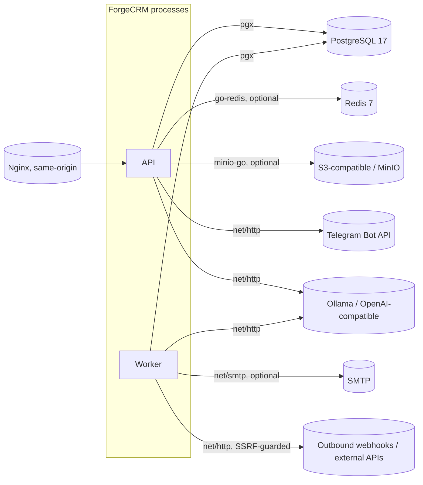

# Dependency map

Code-verified dependency graph at commit `7a6d67f`. Every edge below is a real
non-test import taken from `go list -f '{{.ImportPath}} {{join .Imports " "}}'`.
Nothing here is aspirational.

## How this was produced

```bash
cd backend
go list -f '{{.ImportPath}} {{join .Imports " "}}' ./internal/... ./cmd/... \
  | sed 's#github.com/geff1778/forgecrm/##g'
```

The output was parsed to keep only edges whose target begins with `internal/`,
then out-degrees were counted and cycles were detected with a DFS colouring pass.
The graph and the prose below are the result of that pass, not of reading folder
names.

## Legend

- Solid arrows: a real `internal/…` import.
- Dashed arrows: an external service reached at runtime (not a Go import).
- `⟦cmd⟧`: a composition root (entrypoint), not a reusable module.

---

## Graph — application and domain

```mermaid
graph TD
  subgraph cmd["Composition roots (not modules)"]
    API[⟦cmd/forgecrm-api⟧]
    WORKER[⟦cmd/forgecrm-worker⟧]
    GEN[⟦cmd/openapi-gen⟧]
  end

  subgraph domain["Domain core"]
    CRM[crm]
    ANALYTICS[analytics]
  end

  subgraph app["Application services"]
    IMPORTX[importx]
    MIGRATEX[migratex]
    AI[ai]
    AGENT[agent]
    WORKFLOW[workflow]
    SIMULATE[simulate]
    FORECAST[forecast]
    RISK[risk]
    INTEGRATIONS[integrations]
    EVENTS[events]
    NOTIFY[notify]
    AUTHN[authn]
  end

  subgraph platform["Platform / infrastructure"]
    NETGUARD[netguard]
    RBAC[rbac]
    AUDIT[audit]
    DATABASE[database]
    HTTPX[httpx]
    RATELIMIT[ratelimit]
    RETENTION[retention]
    OBJECTSTORE[objectstore]
    STORAGE[storage]
    JOBS[jobs]
    OUTBOX[outbox]
    SECRETS[secrets]
    CONFIG[config]
    LOGGING[logging]
    MIGRATE["migrate / migrations"]
    OPENAPI[openapi]
    WIRING[wiring]
    ARCHTEST[archtest]
    TESTSUPPORT[testsupport]
  end

  API --> WIRING
  API --> HTTPX
  API --> CONFIG
  API --> DATABASE
  API --> AUTHN
  API --> RBAC
  API --> AUDIT
  API --> SECRETS
  API --> MIGRATE
  API --> LOGGING
  WORKER --> WIRING

  WIRING --> AGENT
  WIRING --> AI
  WIRING --> AUDIT
  WIRING --> AUTHN
  WIRING --> CONFIG
  WIRING --> CRM
  WIRING --> DATABASE
  WIRING --> EVENTS
  WIRING --> FORECAST
  WIRING --> IMPORTX
  WIRING --> INTEGRATIONS
  WIRING --> JOBS
  WIRING --> MIGRATEX
  WIRING --> NOTIFY
  WIRING --> OUTBOX
  WIRING --> RATELIMIT
  WIRING --> RBAC
  WIRING --> RISK
  WIRING --> SECRETS
  WIRING --> SIMULATE
  WIRING --> STORAGE
  WIRING --> WORKFLOW

  %% domain
  CRM --> AUDIT
  CRM --> DATABASE
  CRM --> HTTPX
  CRM --> OUTBOX
  CRM --> RBAC

  %% application
  IMPORTX --> AUDIT
  IMPORTX --> CONFIG
  IMPORTX --> CRM
  IMPORTX --> DATABASE
  IMPORTX --> HTTPX
  IMPORTX --> JOBS
  IMPORTX --> OUTBOX
  IMPORTX --> RBAC
  MIGRATEX --> AUDIT
  MIGRATEX --> DATABASE
  MIGRATEX --> HTTPX
  MIGRATEX --> INTEGRATIONS
  MIGRATEX --> RBAC
  MIGRATEX --> SECRETS
  AI --> AGENT
  AI --> AUDIT
  AI --> CONFIG
  AI --> CRM
  AI --> DATABASE
  AI --> HTTPX
  AI --> LOGGING
  AI --> RATELIMIT
  AI --> RBAC
  AGENT --> AUDIT
  AGENT --> DATABASE
  AGENT --> HTTPX
  WORKFLOW --> AUDIT
  WORKFLOW --> CRM
  WORKFLOW --> DATABASE
  WORKFLOW --> HTTPX
  WORKFLOW --> LOGGING
  WORKFLOW --> OUTBOX
  WORKFLOW --> RBAC
  SIMULATE --> ANALYTICS
  SIMULATE --> AUDIT
  SIMULATE --> CRM
  SIMULATE --> DATABASE
  SIMULATE --> RBAC
  FORECAST --> ANALYTICS
  FORECAST --> AUDIT
  FORECAST --> CRM
  FORECAST --> DATABASE
  FORECAST --> RBAC
  RISK --> ANALYTICS
  RISK --> AUDIT
  RISK --> CRM
  RISK --> DATABASE
  RISK --> RBAC
  INTEGRATIONS --> AUDIT
  INTEGRATIONS --> DATABASE
  INTEGRATIONS --> HTTPX
  INTEGRATIONS --> NETGUARD
  INTEGRATIONS --> RBAC
  INTEGRATIONS --> SECRETS
  EVENTS --> AUDIT
  EVENTS --> DATABASE
  EVENTS --> HTTPX
  EVENTS --> INTEGRATIONS
  EVENTS --> LOGGING
  EVENTS --> OUTBOX
  EVENTS --> RBAC
  EVENTS --> SECRETS
  NOTIFY --> AUDIT
  NOTIFY --> CONFIG
  NOTIFY --> DATABASE
  NOTIFY --> HTTPX
  NOTIFY --> RBAC
  NOTIFY --> SECRETS
  AUTHN --> AUDIT
  AUTHN --> CONFIG
  AUTHN --> DATABASE
  AUTHN --> LOGGING
  AUTHN --> RBAC
  AUTHN --> SECRETS

  %% platform
  RBAC --> DATABASE
  AUDIT --> DATABASE
  AUDIT --> LOGGING
  HTTPX --> LOGGING
  HTTPX --> RATELIMIT
  RETENTION --> AUDIT
  RETENTION --> DATABASE
  OBJECTSTORE --> NETGUARD
  STORAGE --> AUDIT
  STORAGE --> DATABASE
  STORAGE --> HTTPX
  STORAGE --> OBJECTSTORE
  STORAGE --> RBAC
  JOBS --> DATABASE
  OUTBOX --> DATABASE
  OUTBOX --> LOGGING
  CONFIG --> DATABASE
  CONFIG --> HTTPX
  CONFIG --> RETENTION
  MIGRATE --> MIGRATIONS[(migrations)]
  OPENAPI -.->|imported by api| API
```



---

## Graph — external services (runtime, not imports)



Optional services: Redis (rate limiting across replicas), S3 (attachments),
SMTP/Telegram (notifications), an AI provider (assist/MCP). Each reports itself
"off" when unconfigured rather than failing at startup.

---

## Findings

### 1. Cyclic dependencies

**None.** The DFS over the real import graph found no cycle. This is consistent
with `internal/archtest`, which pins the two rules that would create one
(`TestNoPackageImportsAPI`, `TestApplicationServicesDependOnTheCoreAndNotTheReverse`).

### 2. Modules with 8+ internal dependencies

Per the stop-rule "a module with 8+ dependencies is not extract-ready", these are
recorded as `no` in `EXTRACT_READY.md` on this ground alone:

| Package | Internal deps | Note |
| --- | --- | --- |
| `internal/api` | 26 | Composition/HTTP layer — not a module by design. |
| `internal/wiring` | 22 | The composition root itself. |
| `internal/importx` | 10 | Counts its own sub-packages `parsers` and `safe`; 8 if collapsed to top-level. |
| `internal/ai` | 9 | Binds to `crm`, `rbac`, `audit`, `database`. |
| `internal/events` | 8 | Binds to `outbox`, `integrations`, `rbac`, `secrets`. |

`cmd/forgecrm-worker` (17) and `cmd/forgecrm-api` (11) are entrypoints, not
modules, and are excluded from the rule.

### 3. Modules that depend directly on infrastructure

Nearly every application service depends on `database` and `httpx`. The packages
that reach for a *specific* piece of infrastructure rather than the substrate:

- `ratelimit` → Redis (only when `RedisStore` is constructed; `MemoryStore` needs
  nothing).
- `objectstore` → S3/MinIO (`minio-go`), and `netguard` for the endpoint check.
- `storage` → PostgreSQL (metadata rows); it delegates the object mechanism to
  `objectstore`.
- `notify` → SMTP (`net/smtp`), Telegram (HTTP).
- `ai` → an HTTP AI provider.
- `integrations`/`events` → outbound HTTP through `netguard`.

### 4. Modules tied to global application state

There is **no package-level mutable global** used for wiring. State flows through
`wiring.Services` → `api.Deps`. The only ambient state is the transaction carried
on `context.Context` (`database.WithTx` / `database.TxFromContext`), which
`crm` and `audit` read. A module that writes must therefore travel with
`database` or accept a `Querier`.

### 5. Modules that cannot be extracted without moving much of the monolith

- `api`, `wiring`, `config`, `openapi`, `migrate`, `migrations`, `testsupport`
  are structurally application-wide. Extraction is not the goal for these.

### 6. Common infrastructure components (shared by everyone)

`database`, `logging`, `httpx`, `rbac`, `audit`, `secrets`, `config`. These are
the components an extraction must either carry or invert behind an interface.
The lightest — `analytics`, `netguard` (both zero internal dependencies) and
`logging`/`secrets` — are the natural first extractions, and `analytics` and
`netguard` have been extracted and proven by `scripts/extract-test/`.

### 7. Dependency direction (the rule the code follows)

```
domain (crm, analytics)
   ↑
application (importx, migratex, ai, agent, workflow, simulate, forecast, risk,
             integrations, events, notify, authn)
   ↑
platform (netguard, rbac, audit, database, httpx, ratelimit, retention,
          objectstore, storage, jobs, outbox, secrets, config, logging)
   ↑
composition (wiring, api, cmd/*)
```

`httpx` importing `ratelimit` is the one edge where a platform package reaches
"sideways" into another platform package; it is intentional (the rate-limit
middleware lives with the other middleware) and creates no cycle. `httpx` also
depends on `logging`. Those two are its only in-module dependencies, and both are
proven leaves, so `httpx` is itself extractable and is proven so by the harness in
`scripts/extract-test/httpx`.

`importx`'s two sub-packages, `parsers` and `safe`, are leaves: neither imports
anything else in this module. `safe` (untrusted-archive extraction) and `parsers`
(tabular source parsing) are both extracted and proven by
`scripts/extract-test/safe` and `scripts/extract-test/parsers`; the service in
`importx` itself remains application code.

`database` is a leaf: it imports nothing else in this module, and it is extracted
and proven by `scripts/extract-test/database`. `rbac`'s only in-module dependency
is `database`, so it is extracted with it by `scripts/extract-test/rbac`; the
archtest pins that `rbac` may import `database` and nothing else. `audit` and
`outbox` are built on `database` and `logging` and on nothing else, and both are
extracted and proven by `scripts/extract-test/audit` and
`scripts/extract-test/outbox`; the archtest pins that boundary too. `retention` is
built on `audit` and `database`, and `agent` on `audit`, `database` and `httpx` —
the widest proven set — and both are extracted and proven by
`scripts/extract-test/retention` and `scripts/extract-test/agent`. `jobs` is built
on `database` alone; `crm` on `database`, `audit`, `httpx`, `outbox` and `rbac`;
`storage` on `database`, `audit`, `httpx`, `objectstore` (and its `netguard`),
`ratelimit` and `rbac`; and `integrations` on `database`, `audit`, `httpx`,
`netguard`, `rbac` and `secrets`. All four are extracted and proven by
`scripts/extract-test/{jobs,crm,storage,integrations}`.
