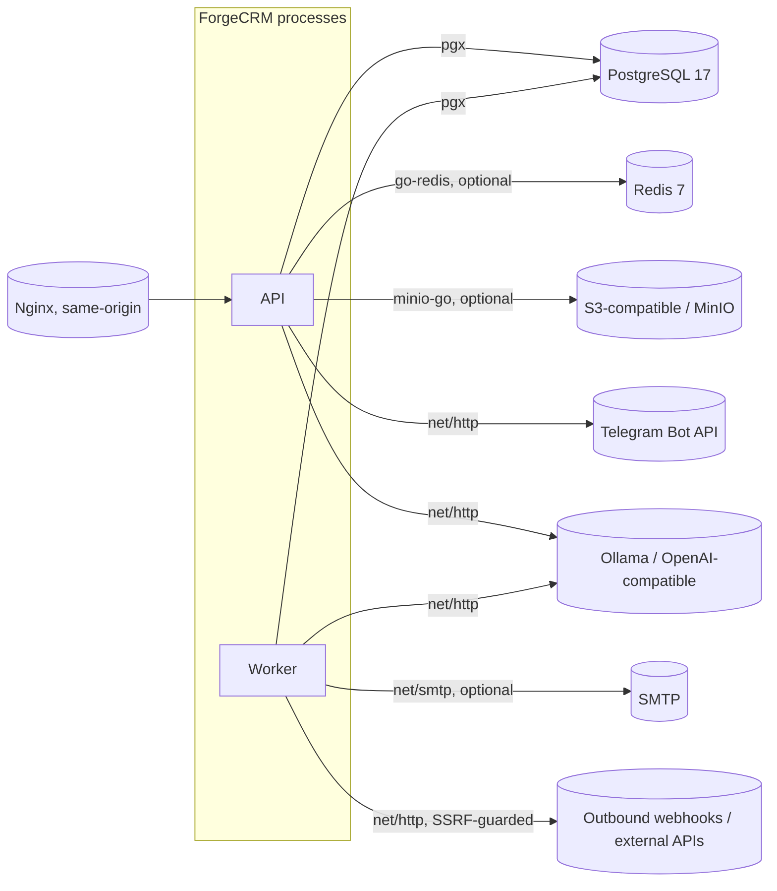

```mermaid
graph TD
  subgraph cmd["Composition roots (not modules)"]
    API[⟦cmd/forgecrm-api⟧]
    WORKER[⟦cmd/forgecrm-worker⟧]
    GEN[⟦cmd/openapi-gen⟧]
  end

  subgraph domain["Domain core"]
    CRM[crm]
    ANALYTICS[analytics]
  end

  subgraph app["Application services"]
    IMPORTX[importx]
    MIGRATEX[migratex]
    AI[ai]
    AGENT[agent]
    WORKFLOW[workflow]
    SIMULATE[simulate]
    FORECAST[forecast]
    RISK[risk]
    INTEGRATIONS[integrations]
    EVENTS[events]
    NOTIFY[notify]
    AUTHN[authn]
  end

  subgraph platform["Platform / infrastructure"]
    NETGUARD[netguard]
    RBAC[rbac]
    AUDIT[audit]
    DATABASE[database]
    HTTPX[httpx]
    RATELIMIT[ratelimit]
    RETENTION[retention]
    OBJECTSTORE[objectstore]
    STORAGE[storage]
    JOBS[jobs]
    OUTBOX[outbox]
    SECRETS[secrets]
    CONFIG[config]
    LOGGING[logging]
    MIGRATE["migrate / migrations"]
    OPENAPI[openapi]
    WIRING[wiring]
    ARCHTEST[archtest]
    TESTSUPPORT[testsupport]
  end

  API --> WIRING
  API --> HTTPX
  API --> CONFIG
  API --> DATABASE
  API --> AUTHN
  API --> RBAC
  API --> AUDIT
  API --> SECRETS
  API --> MIGRATE
  API --> LOGGING
  WORKER --> WIRING

  WIRING --> AGENT
  WIRING --> AI
  WIRING --> AUDIT
  WIRING --> AUTHN
  WIRING --> CONFIG
  WIRING --> CRM
  WIRING --> DATABASE
  WIRING --> EVENTS
  WIRING --> FORECAST
  WIRING --> IMPORTX
  WIRING --> INTEGRATIONS
  WIRING --> JOBS
  WIRING --> MIGRATEX
  WIRING --> NOTIFY
  WIRING --> OUTBOX
  WIRING --> RATELIMIT
  WIRING --> RBAC
  WIRING --> RISK
  WIRING --> SECRETS
  WIRING --> SIMULATE
  WIRING --> STORAGE
  WIRING --> WORKFLOW

  %% domain
  CRM --> AUDIT
  CRM --> DATABASE
  CRM --> HTTPX
  CRM --> OUTBOX
  CRM --> RBAC

  %% application
  IMPORTX --> AUDIT
  IMPORTX --> CONFIG
  IMPORTX --> CRM
  IMPORTX --> DATABASE
  IMPORTX --> HTTPX
  IMPORTX --> JOBS
  IMPORTX --> OUTBOX
  IMPORTX --> RBAC
  MIGRATEX --> AUDIT
  MIGRATEX --> DATABASE
  MIGRATEX --> HTTPX
  MIGRATEX --> INTEGRATIONS
  MIGRATEX --> RBAC
  MIGRATEX --> SECRETS
  AI --> AGENT
  AI --> AUDIT
  AI --> CONFIG
  AI --> CRM
  AI --> DATABASE
  AI --> HTTPX
  AI --> LOGGING
  AI --> RATELIMIT
  AI --> RBAC
  AGENT --> AUDIT
  AGENT --> DATABASE
  AGENT --> HTTPX
  WORKFLOW --> AUDIT
  WORKFLOW --> CRM
  WORKFLOW --> DATABASE
  WORKFLOW --> HTTPX
  WORKFLOW --> LOGGING
  WORKFLOW --> OUTBOX
  WORKFLOW --> RBAC
  SIMULATE --> ANALYTICS
  SIMULATE --> AUDIT
  SIMULATE --> CRM
  SIMULATE --> DATABASE
  SIMULATE --> RBAC
  FORECAST --> ANALYTICS
  FORECAST --> AUDIT
  FORECAST --> CRM
  FORECAST --> DATABASE
  FORECAST --> RBAC
  RISK --> ANALYTICS
  RISK --> AUDIT
  RISK --> CRM
  RISK --> DATABASE
  RISK --> RBAC
  INTEGRATIONS --> AUDIT
  INTEGRATIONS --> DATABASE
  INTEGRATIONS --> HTTPX
  INTEGRATIONS --> NETGUARD
  INTEGRATIONS --> RBAC
  INTEGRATIONS --> SECRETS
  EVENTS --> AUDIT
  EVENTS --> DATABASE
  EVENTS --> HTTPX
  EVENTS --> INTEGRATIONS
  EVENTS --> LOGGING
  EVENTS --> OUTBOX
  EVENTS --> RBAC
  EVENTS --> SECRETS
  NOTIFY --> AUDIT
  NOTIFY --> CONFIG
  NOTIFY --> DATABASE
  NOTIFY --> HTTPX
  NOTIFY --> RBAC
  NOTIFY --> SECRETS
  AUTHN --> AUDIT
  AUTHN --> CONFIG
  AUTHN --> DATABASE
  AUTHN --> LOGGING
  AUTHN --> RBAC
  AUTHN --> SECRETS

  %% platform
  RBAC --> DATABASE
  AUDIT --> DATABASE
  AUDIT --> LOGGING
  HTTPX --> LOGGING
  HTTPX --> RATELIMIT
  RETENTION --> AUDIT
  RETENTION --> DATABASE
  OBJECTSTORE --> NETGUARD
  STORAGE --> AUDIT
  STORAGE --> DATABASE
  STORAGE --> HTTPX
  STORAGE --> OBJECTSTORE
  STORAGE --> RBAC
  JOBS --> DATABASE
  OUTBOX --> DATABASE
  OUTBOX --> LOGGING
  CONFIG --> DATABASE
  CONFIG --> HTTPX
  CONFIG --> RETENTION
  MIGRATE --> MIGRATIONS[(migrations)]
  OPENAPI -.->|imported by api| API
```

# Карта зависимостей

Проверенный по коду граф зависимостей на коммите `7a6d67f`. Каждое ребро ниже —
реальный не-тестовый импорт, взятый из `go list -f '{{.ImportPath}} {{join .Imports " "}}'`.
Здесь нет ничего умозрительного.

## Как это получено

```bash
cd backend
go list -f '{{.ImportPath}} {{join .Imports " "}}' ./internal/... ./cmd/... \
  | sed 's#github.com/geff1778/forgecrm/##g'
```

Вывод был разобран, чтобы оставить только рёбра, чья цель начинается с `internal/`,
затем были посчитаны исходящие степени и циклы обнаружены проходом раскраски DFS.
Граф и текст ниже — результат того прохода, а не чтения имён папок.

## Легенда

- Сплошные стрелки: реальный импорт `internal/…`.
- Пунктирные стрелки: внешний сервис, достигаемый во время исполнения (не импорт Go).
- `⟦cmd⟧`: корень композиции (точка входа), не переиспользуемый модуль.

---

## Граф — приложение и домен



---

## Граф — внешние сервисы (во время исполнения, не импорты)



Опциональные сервисы: Redis (ограничение частоты между репликами), S3 (вложения),
SMTP/Telegram (уведомления), провайдер ИИ (assist/MCP). Каждый сообщает о себе «off»,
когда не настроен, а не падает при старте.

---

## Находки

### 1. Циклические зависимости

**Нет.** DFS по реальному графу импортов не нашёл цикла. Это согласуется с
`internal/archtest`, который закрепляет два правила, которые создали бы цикл
(`TestNoPackageImportsAPI`, `TestApplicationServicesDependOnTheCoreAndNotTheReverse`).

### 2. Модули с 8+ внутренними зависимостями

Согласно правилу остановки «модуль с 8+ зависимостями не готов к выделению», они
записаны как `no` в `EXTRACT_READY.md` уже на этом основании:

| Пакет | Внутренних зависимостей | Примечание |
| --- | --- | --- |
| `internal/api` | 26 | Слой композиции/HTTP — по дизайну не модуль. |
| `internal/wiring` | 22 | Сам корень композиции. |
| `internal/importx` | 10 | Считает собственные подпакеты `parsers` и `safe`; 8 при свёртке до верхнего уровня. |
| `internal/ai` | 9 | Связывается с `crm`, `rbac`, `audit`, `database`. |
| `internal/events` | 8 | Связывается с `outbox`, `integrations`, `rbac`, `secrets`. |

`cmd/forgecrm-worker` (17) и `cmd/forgecrm-api` (11) — точки входа, а не модули, и
исключены из правила.

### 3. Модули, зависящие напрямую от инфраструктуры

Почти каждый прикладной сервис зависит от `database` и `httpx`. Пакеты, тянущиеся к
*конкретной* части инфраструктуры, а не к субстрату:

- `ratelimit` → Redis (только когда строится `RedisStore`; `MemoryStore` не нуждается
  ни в чём).
- `objectstore` → S3/MinIO (`minio-go`) и `netguard` для проверки эндпоинта.
- `storage` → PostgreSQL (строки метаданных); механизм объектов он делегирует
  `objectstore`.
- `notify` → SMTP (`net/smtp`), Telegram (HTTP).
- `ai` → HTTP-провайдер ИИ.
- `integrations`/`events` → исходящий HTTP через `netguard`.

### 4. Модули, привязанные к глобальному состоянию приложения

**Пакетной изменяемой глобальной переменной** для связывания нет. Состояние течёт
через `wiring.Services` → `api.Deps`. Единственное окружающее состояние — транзакция,
несомая на `context.Context` (`database.WithTx` / `database.TxFromContext`), которую
читают `crm` и `audit`. Модуль, который пишет, поэтому должен путешествовать с
`database` или принимать `Querier`.

### 5. Модули, которые нельзя выделить без переноса большей части монолита

- `api`, `wiring`, `config`, `openapi`, `migrate`, `migrations`, `testsupport`
  структурно общеприкладные. Выделение для них не цель.

### 6. Общие компоненты инфраструктуры (используемые всеми)

`database`, `logging`, `httpx`, `rbac`, `audit`, `secrets`, `config`. Это компоненты,
которые выделение должно либо нести, либо инвертировать за интерфейсом. Самые лёгкие —
`analytics`, `netguard` (оба с нулём внутренних зависимостей) и `logging`/`secrets` —
естественные первые выделения, и `analytics` и `netguard` выделены и доказаны
`scripts/extract-test/`.

### 7. Направление зависимостей (правило, которому следует код)

```
domain (crm, analytics)
   ↑
application (importx, migratex, ai, agent, workflow, simulate, forecast, risk,
             integrations, events, notify, authn)
   ↑
platform (netguard, rbac, audit, database, httpx, ratelimit, retention,
          objectstore, storage, jobs, outbox, secrets, config, logging)
   ↑
composition (wiring, api, cmd/*)
```

`httpx`, импортирующий `ratelimit`, — единственное ребро, где платформенный пакет
тянется «вбок» в другой платформенный пакет; это намеренно (middleware ограничения
частоты живёт с остальным middleware) и не создаёт цикла. `httpx` также зависит от
`logging`. Эти двое — его единственные внутренние зависимости, и оба доказаны как
листья, поэтому `httpx` сам извлекаем и доказан как таковой набором в
`scripts/extract-test/httpx`.

Два подпакета `importx`, `parsers` и `safe`, — листья: ни один не импортирует что-либо
ещё в этом модуле. `safe` (распаковка недоверенных архивов) и `parsers` (разбор
табличных источников) оба выделены и доказаны `scripts/extract-test/safe` и
`scripts/extract-test/parsers`; сам сервис в `importx` остаётся прикладным кодом.

`database` — лист: он не импортирует ничего ещё в этом модуле, и он выделен и доказан
`scripts/extract-test/database`. Единственная внутренняя зависимость `rbac` —
`database`, поэтому он выделяется вместе с ним через `scripts/extract-test/rbac`;
archtest закрепляет, что `rbac` может импортировать `database` и ничего больше. `audit`
и `outbox` построены на `database` и `logging` и ни на чём больше, и оба выделены и
доказаны `scripts/extract-test/audit` и `scripts/extract-test/outbox`; archtest
закрепляет и эту границу. `retention` построен на `audit` и `database`, а `agent` — на
`audit`, `database` и `httpx` — самый широкий доказанный набор — и оба выделены и
доказаны `scripts/extract-test/retention` и `scripts/extract-test/agent`. `jobs` построен
только на `database`; `crm` — на `database`, `audit`, `httpx`, `outbox` и
`rbac`; `storage` — на `database`, `audit`, `httpx`, `objectstore` (и его `netguard`),
`ratelimit` и `rbac`; а `integrations` — на `database`, `audit`, `httpx`, `netguard`,
`rbac` и `secrets`. Все четыре выделены и доказаны
`scripts/extract-test/{jobs,crm,storage,integrations}`.
