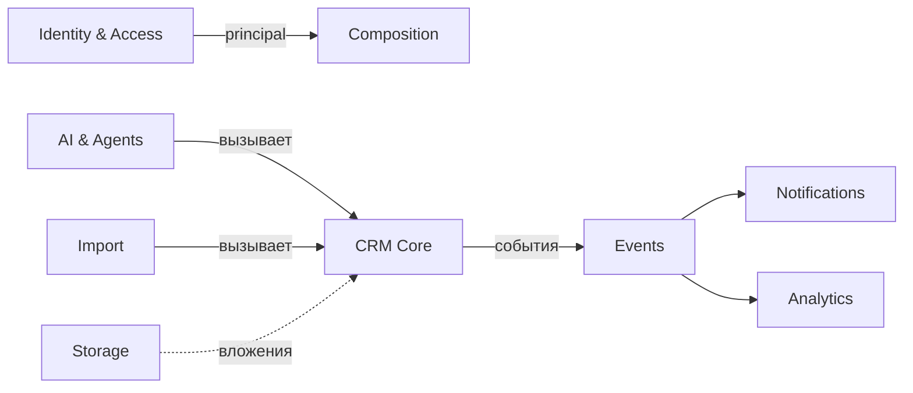

# Bounded contexts ForgeCRM

> Соответствует реальному коду на `main` @ `3424b3e`. Контекст = пакет(и) с
> явной ответственностью и границей, обеспеченной `internal/archtest`.

## Карта контекстов

| Контекст | Пакеты | Ответственность | Не делает |
|---|---|---|---|
| Композиция | `wiring`, `api` | сборка графа, HTTP-маршрутизация | доменные правила |
| Идентичность и доступ | `authn`, `oidc`, `rbac` | вход, сессии, MFA, SSO, права | доменные данные CRM |
| CRM-ядро | `crm` | аккаунты, контакты, лиды, сделки, задачи, обращения, активности, поиск, отчёты | транспорт, отправка, сеть |
| Импорт | `importx` (+`safe`,`parsers`) | разбор и исполнение импорта | владение CRM-данными |
| Миграция | `migratex` | перенос из внешних источников, сверка | — |
| Интеграции | `integrations`, `events`, `netguard` | адаптеры, вебхуки, SSRF-защита | доменные правила |
| Уведомления | `notify`, `consent`, `telegramtext` | email/Telegram, согласие, локализация | доменные данные |
| ИИ и агенты | `ai`, `agent`, `mcpcred` | провайдеры, инструменты, MCP, HITL | доменные правила (вызывает `crm`) |
| Аналитика | `analytics`, `forecast`, `risk`, `simulate` | арифметика и отчёты | запись CRM |
| Хранилище | `storage`, `objectstore` | документы, вложения | доменные правила |
| Платформа | `jobs`, `outbox`, `idempotency`, `audit`, `metrics`, `logging`, `tracectx`, `ratelimit`, `secrets`, `config`, `retention`, `tenantconfig`, `views`, `appearance`, `migrations`, `migrate` | сквозные механизмы | доменные правила |

## Границы

Направление: `api → application → crm → platform`. Обеспечено:

- `TestApplicationServicesDependOnTheCoreAndNotTheReverse`
- `TestNoPackageImportsAPI`
- `TestCoreDoesNotImportCompositionOrHTTP`
- `TestExtractionBoundaryHolds`
- 0 циклов (см. `audit/DEPENDENCY_MAP.md`)

## Ubiquitous language (примеры)

- **Deal** — сделка; стадии и история в `crm`.
- **Pipeline** — воронка и стадии.
- **Ticket** — обращение поддержки; SLA.
- **Outbox event** — событие, записанное в транзакции.
- **Principal** — аутентифицированный субъект с правами (`rbac`).
- **Tenant** — организация (`organization_id`).

## Контекстная карта (Mermaid)

