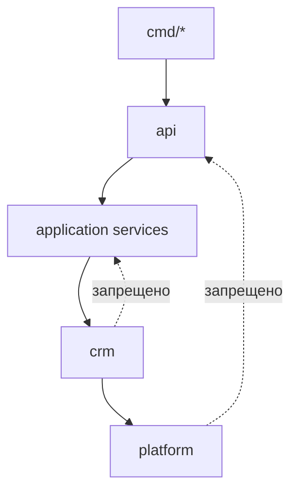

# Правила зависимостей ForgeCRM

> Правила изложены в ADR 0001 и **обеспечены тестами** `internal/archtest`,
> читающими реальный граф импортов через `go list`.

## Правила

1. `api → application → crm → platform`. Обратное направление запрещено.
2. Ни один пакет не импортирует `internal/api` (композиция сверху).
3. Ядро (`crm`) не импортирует композицию или HTTP-транспорт.
4. Тест-скаффолд (`testsupport`, `testdb`, `testfixture`) не попадает в прод-код.
5. Нет циклов.
6. Каждый `internal/`-пакет достижим из какой-либо команды (нет мёртвых пакетов).
7. Границы извлечения держатся: модуль из `scripts/extract-test/modules.txt`
   обязан извлекаться.

## Обеспечивающие тесты

| Правило | Тест |
|---|---|
| 1 | `TestApplicationServicesDependOnTheCoreAndNotTheReverse` |
| 2 | `TestNoPackageImportsAPI` |
| 3 | `TestCoreDoesNotImportCompositionOrHTTP` |
| 4 | `TestProductionPackagesDoNotImportTestsupport` |
| 5 | 0 циклов (см. `audit/DEPENDENCY_MAP.md`) |
| 6 | `TestEveryInternalPackageIsReachableFromACommand` |
| 7 | `TestExtractionBoundaryHolds` + `scripts/extract-test/run.sh` |

## Известное отклонение

`crm` импортирует `httpx` (доменные ошибки, пагинация, сортировка). Однонаправленно,
цикла нет; закреплено тестом и записано как TD-1 в `audit/TECHNICAL_DEBT.md`.

## Диаграмма направления (Mermaid)

