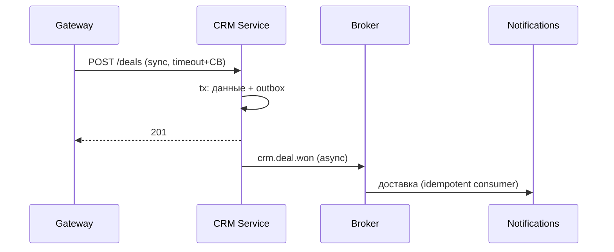

# Межмодульное взаимодействие ForgeCRM

> Описывает **текущее** взаимодействие внутри модульного монолита и целевое для
> микросервисов.

## Текущее (в процессе)

- Вызовы — **внутрипроцессные**, через экспортируемые Go-типы. HTTP-обработчик,
  MCP-инструмент, workflow и worker вызывают **один и тот же** `crm.Service`.
- Асинхронность — через outbox (событие в той же транзакции) + worker.
- Нет сетевых вызовов между модулями: нет таймаутов, retry, circuit breaker между
  ними — потому что нет границы процесса.

Преимущество: бизнес-правило существует один раз; права и валидация не расходятся.

## Целевое (микросервисы, не реализовано)

| Вид | Когда | Механизм |
|---|---|---|
| Синхронный | нужен немедленный ответ | HTTP/gRPC, таймаут + circuit breaker |
| Асинхронный | всё остальное | события через брокер (outbox → топик) |

Обязательные свойства (часть уже есть в коде):

- **Event contracts** — `EVENT_CATALOG.md` (28 типов).
- **Версионирование событий** — `schema_version`.
- **Transactional Outbox** — `internal/outbox`.
- **Idempotent consumers** — `internal/idempotency`.
- **Retry с backoff** — `internal/jobs`, `internal/events`.
- **Dead Letter Queue** — `internal/events`.
- **Correlation ID** — `tracectx`, поле `correlation_id`.
- **Timeout / circuit breaker** — добавить на межсервисных вызовах.

Распределённые транзакции не допускаются без необходимости; кросс-доменные
операции — сага с явными компенсациями.

## Диаграмма (цель)

