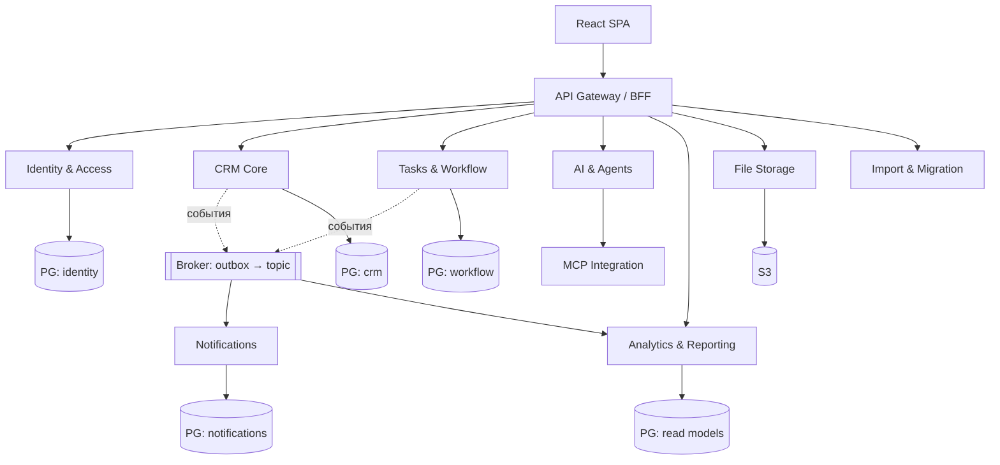

# Микросервисная архитектура ForgeCRM (целевая)

> **СТАТУС: НЕ РЕАЛИЗОВАНО.** На `main` @ `3424b3e` работает модульный монолит.
> Этот документ описывает **целевой** дизайн Этапа C и то, что мешает его начать.
> Он **не** является описанием существующей системы — см. `MODULAR_MONOLITH.md`
> для факта. Не путайте цель с реализацией.

## 1. Что уже готово к микросервисам (факт)

- **0 циклов** в графе зависимостей.
- **36 модулей** извлекаются в чистый Go-модуль и там собираются, тестируются и
  запускаются (`EXTRACT_RC=0`).
- Событийная инфраструктура: outbox, `schema_version`, `correlation_id`,
  retry с backoff, dead-letter.
- Идемпотентность изменяющих операций (`internal/idempotency`).
- Health/readiness endpoints, метрики Prometheus, структурированные логи.

Это означает: **направление зависимостей и переносимость уже обеспечены**. Работа
Этапа C — не «распилить монолит», а решить вопросы данных и протоколов.

## 2. Что блокирует микросервисы (факт)

| Блокер | Где | Почему мешает |
|---|---|---|
| **Общая схема БД** (TD-2) | `internal/migrations` (83 таблицы) | «Сервисы» будут делить таблицы и станут распределённым монолитом; запрет межсервисного доступа к данным нельзя обеспечить технически |
| **Транзакционный домен** | `crm`, `audit`, `outbox` | Архивирование контакта + запись в аудит сейчас коммитятся вместе; через сеть это сага |
| **ADR 0001/0002** | `docs/adr/` | Прямо отклоняют микросервисы до достижения триггеров; требуют отмены/замены ADR для Этапа C |

**Вывод:** начинать Этап C без решения по владению данными и без явного решения
владельца об ADR — значит создать фиктивные сервисы, что запрещено правилом 9.

## 3. Целевые сервисы (кандидаты, не обязательство)

Из требований программы, с учётом тесной связи областей:

| Сервис | Bounded context | Источник в коде | Обоснование отдельного развёртывания |
|---|---|---|---|
| **API Gateway / BFF** | композиция | `api` + `wiring` | единая точка для фронтенда |
| **Identity & Access** | идентичность | `authn`, `oidc`, `rbac` | отдельная поверхность безопасности, свой темп изменений |
| **CRM Core** | аккаунты/контакты/сделки/задачи/тикеты | `crm` | ядро; транзакционное |
| **Tasks & Workflow** | задачи/автоматизация | `crm` (задачи) + `workflow` | фоновые триггеры, свой профиль нагрузки |
| **Notifications** | уведомления | `notify`, `consent`, `telegramtext` | исходящий трафик, свои лимиты |
| **AI & Agents** | ИИ | `ai`, `agent` | прожорлив к памяти, импульсный |
| **MCP Integration** | MCP-протокол | `ai` (MCP) + `mcpcred` | внешняя поверхность инструментов |
| **Analytics & Reporting** | аналитика | `analytics`, `forecast`, `risk`, `simulate` | только чтение, можно масштабировать отдельно |
| **File Storage** | файлы | `storage`, `objectstore` | отдельный ресурс (S3) |
| **Import & Migration** | импорт | `importx`, `migratex` | импульсная тяжёлая нагрузка |

> **Решение по объединению:** Accounts/Contacts, Deals/Sales и Tasks/Workflow
> тесно связаны с CRM Core транзакционно. Их выделение в отдельные сервисы **не
> даёт практической пользы** и создаёт распределённые транзакции. Рекомендуется
> оставить их в **CRM Core** и выделять только по триггерам ADR 0002.

## 4. Целевые контейнеры (Mermaid, цель)

## 5. Взаимодействие (целевое)

- **Синхронно** (HTTP/gRPC) — когда нужен немедленный ответ (BFF → сервис).
- **Асинхронно** (события) — всё остальное. Уже есть: outbox, `schema_version`,
  `correlation_id`, retry, DLQ, идемпотентные консьюмеры.
- **Таймауты и circuit breaker** — на каждом межсервисном вызове.
- **Никаких распределённых транзакций** без серьёзной необходимости: для
  кросс-доменных операций — сага с компенсациями, явно описанная.

## 6. Данные (целевое, критично)

- **Разделение схем**: `CREATE SCHEMA identity, crm, workflow, notifications, …` в
  одном инстансе PostgreSQL (допустимо программой) **или** отдельные базы.
- **Запрет прямого доступа к чужим таблицам** — обеспечивается тестом-хранителем
  графа SQL-обращений (TD-2).
- Межсервисные данные — только через API, события или read models.

## 7. Что должно предшествовать Этапу C

1. Явное решение владельца: заменить/отозвать ADR 0001 (см. ADR 0013).
2. Разделение схем и тест-хранитель владения данными (TD-2).
3. Контракты событий и версионирование (частично есть).
4. Пилот на **одном** сервисе с наименьшей связностью (кандидат: `analytics` или
   `notifications`), а не «распил всего сразу».

## 8. Честный итог

Микросервисная реализация **не начата** и не должна начинаться массовой миграцией.
Направление зависимостей и переносимость уже готовы; недостаёт решения по данным и
ADR. Пока решения нет — `main` остаётся эталонным модульным монолитом, а Этап E
(переносимые модули) даёт реальную ценность без риска.
