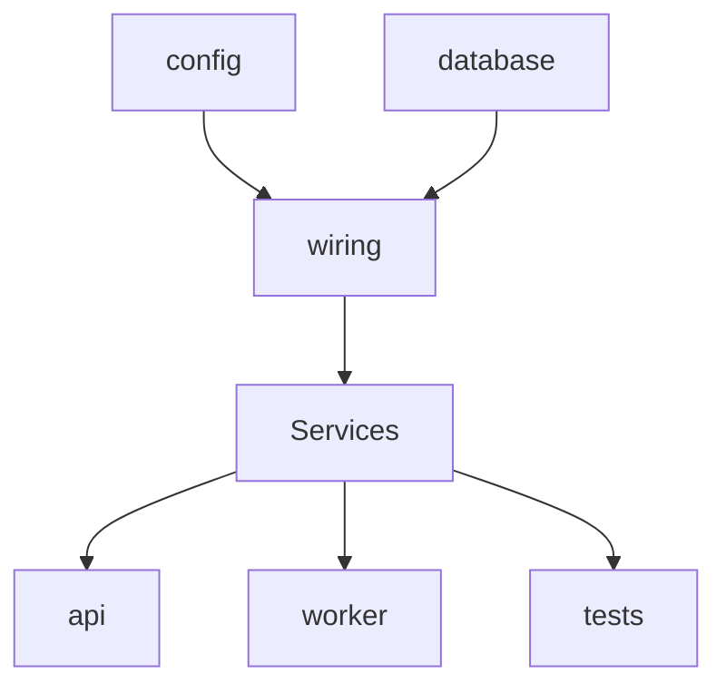

# Модульный монолит ForgeCRM

> Статус: **реализовано в `main`** (`3424b3e`). Это описание существующей
> архитектуры, а не план. Решение зафиксировано в ADR 0001.

## 1. Почему именно модульный монолит

ForgeCRM — транзакционный домен. Архивирование контакта, конвертация лида,
перемещение сделки и запись в аудит должны произойти **вместе или никак**. В
микросервисах это означало бы распределённые транзакции и саги. Команда мала, а
эксплуатационный бюджет — один сервер. Поэтому: один Go-модуль, две точки входа
(API и worker), границы обеспечиваются направлением зависимостей, а не сетью.

Домены не распределены преждевременно. Выделение — измеренное решение с триггерами
(ADR 0002), а не вкусовое.

## 2. Bounded contexts (по коду)

| Контекст | Пакеты | Владеет |
|---|---|---|
| Композиция | `wiring`, `api` | маршрутизация, сборка графа |
| Идентичность и доступ | `authn`, `oidc`, `rbac` | users, sessions, roles, permissions |
| Ядро CRM | `crm` | accounts, contacts, leads, deals, pipelines, tasks, tickets, activities |
| Импорт и миграция | `importx` (+`safe`,`parsers`), `migratex` | import_jobs, миграция источников |
| Интеграции | `integrations`, `events`, `netguard` | integrations, webhook-доставка |
| Уведомления | `notify`, `consent`, `telegramtext` | notifications, доставка |
| ИИ и агенты | `ai`, `agent`, `mcpcred` | провайдеры, инструменты, MCP, HITL |
| Аналитика | `analytics`, `forecast`, `risk`, `simulate` | (только чтение CRM) |
| Хранилище | `storage`, `objectstore` | documents, attachments |
| Платформа | `jobs`, `outbox`, `idempotency`, `audit`, `metrics`, `logging`, `tracectx`, `ratelimit`, `secrets`, `config`, `retention`, `tenantconfig`, `views`, `appearance`, `migrations`, `migrate` | сквозные механизмы |

## 3. Как обеспечиваются границы

Границы держатся **тремя** механизмами, каждый проверяем:

1. **Правило направления** — `api → application → core → platform`. Обеспечено
   `internal/archtest` (6 тестов), читающих реальный граф импортов через `go list`.
2. **Запрет циклов** — 0 циклов на аудируемом коммите (воспроизводимо, см.
   `audit/DEPENDENCY_MAP.md`).
3. **Харнесс извлечения** — `scripts/extract-test` копирует модуль в чистый Go-модуль
   и там собирает, тестирует и запускает. 36/36 модулей проходят (`EXTRACT_RC=0`).

Пакет `crm` не может импортировать прикладной сервис, потому что это создало бы
цикл и уронило `TestApplicationServicesDependOnTheCoreAndNotTheReverse`. Никто не
импортирует `api`, потому что это уронило бы `TestNoPackageImportsAPI`.

## 4. Единая точка композиции

`internal/wiring.Services` собирает все зависимости из конфигурации и хендла БД.
API, worker и тесты используют **один и тот же** граф, поэтому тест не может
разойтись с продакшеном.

## 5. Сквозные механизмы — библиотеки, не сервисы

Аудит, RBAC, согласие, публикация событий — это **код в процессе**, а не отдельные
сервисы. Новый вызывающий не может их обойти, вызвав другой сервис: другого сервиса
нет. Это свойство нельзя воспроизвести в микросервисах без больших затрат.

## 6. Тестирование модуля отдельно

Каждый модуль тестируется независимо тремя способами:

1. `go test ./internal/<pkg>/...` — unit.
2. `go test -tags=integration ./internal/<pkg>/...` — против реального PostgreSQL.
3. `scripts/extract-test/run.sh <pkg>` — сборка/тест/запуск вне монолита.

## 7. Сравнение с микросервисами

| Свойство | Модульный монолит (`main`) | Микросервисы (цель Этапа C) |
|---|---|---|
| Транзакции | локальные, атомарные | распределённые (саги) |
| Изоляция ресурсов | грубая (API/worker раздельно) | полная по сервисам |
| Деплой | один артефакт | независимый по сервису |
| Наблюдаемость | один процесс | трассировка через границы |
| Стоимость ошибки | один деплой влияет на всё | изолированный отказ |
| Готовность кода | **есть** | **нет** (требует Этапа C) |

## 8. Ограничения (честно)

- Общая схема БД (TD-2): владение данными логическое, не физическое.
- Изоляция ресурсов грубая.
- Изменение общего пакета пересобирает всё.
- Правило границ обеспечивается тестами и ревью, а не компилятором.

Эти ограничения — цена выбранной архитектуры, а не дефекты. Для текущего масштаба
она оправдана; триггеры выделения зафиксированы в ADR 0002.
