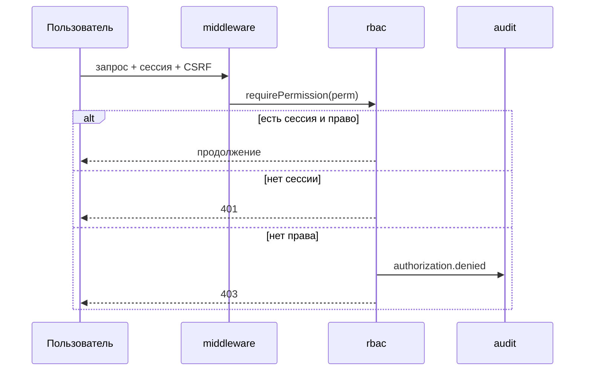

# Модель безопасности ForgeCRM

> Соответствует коду на `main` @ `3424b3e`. Детальный разбор — в
> `audit/SECURITY_AUDIT.md`.

## Субъекты и доверие

| Субъект | Как аутентифицируется | Что может |
|---|---|---|
| Человек (браузер) | сессия (Argon2id+MFA) или OIDC | права роли в организации |
| MCP-клиент | MCP-токен | **не больше** прав владельца токена |
| Вебхук-отправитель | HMAC-SHA256 + timestamp | доставить событие |
| Интеграция | секрет адаптера | ограниченные вызовы |

## Аутентификация

- Argon2id (`internal/secrets`), непрозрачные сессии, CSRF-токен, блокировка, TOTP
  MFA, сброс пароля, шаг-ап.
- Session fixation исключён: новый токен на входе и на MFA (`authn.go`).
- OIDC: authorization-code flow, state привязан к cookie браузера (`oidc`).
- Cookie: `HttpOnly`, `Secure` (по конфигу), `SameSite` (по конфигу).

## Авторизация

- RBAC — данные (`internal/rbac`, 103 разрешения, 14 ролей).
- Проверка **на сервере** (`requirePermission`): 401 без сессии, 403 без права;
  отказ пишется в аудит.
- Frontend-скрытие — не защита.

## Изоляция

- Арендатор: обязательный `organization_id`, фильтрация в `crm`; тесты изоляции.
- BOLA/IDOR: закрыто (тесты `isolation_cases_test.go`, `tenant_isolation_test.go`).

## Транспорт и заголовки

- `X-Content-Type-Options: nosniff`, `X-Frame-Options: DENY`, CSP (enforce/report),
  HSTS при настроенном max-age (`internal/httpx`).

## Внешние поверхности

- SSRF: `internal/netguard` для исходящих интеграций.
- Вебхуки: подпись + окно времени + DLQ.
- Секреты: не в репозитории, маскируются в логах; gitleaks в CI.
- Уязвимые зависимости: govulncheck; статический анализ: gosec (базовая линия).

## Диаграмма авторизации (Mermaid)

