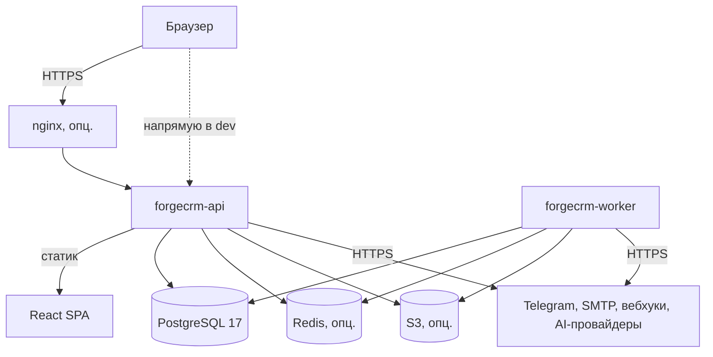
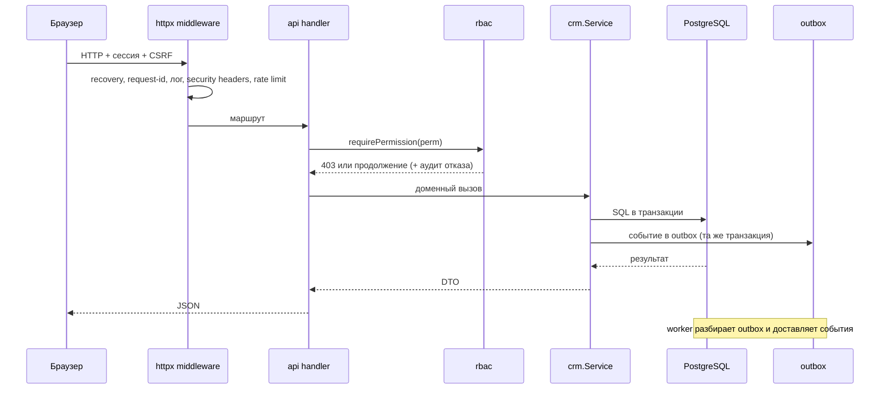
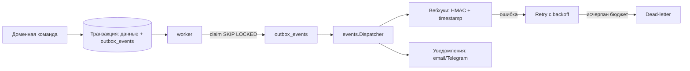

# ForgeCRM — обзор системы

> Статус: **описывает реальный код** на `main` @ `3424b3e`, а не желаемое.

## 1. Что это

Самостоятельно размещаемая CRM-платформа: бэкенд на Go + PostgreSQL, фронтенд на
React 19 + TypeScript + Vite. Ядро (аккаунты, контакты, лиды, сделки, задачи,
обращения, активности, поиск, отчёты) работает **без** ИИ и без внешних
интеграций. ИИ, импорт, интеграции, события, уведомления, MCP, Telegram и SMTP —
опциональные подсистемы, которые деградируют до `disabled`.

## 2. Процессы и хранилища

| Компонент | Что это | Точка входа |
|---|---|---|
| API | HTTP-сервер, `/api/v1`, отдаёт статику фронтенда | `backend/cmd/forgecrm-api` |
| Worker | фоновые задания, разбор outbox, доставка вебхуков/уведомлений | `backend/cmd/forgecrm-worker` |
| Constructor | CLI-генератор проектов из рецептов | `backend/cmd/forgecrm` |
| PostgreSQL 17 | состояние, jobs, outbox, аудит | — |
| Redis (опц.) | распределённый rate limit и общие счётчики | — |
| S3-совместимое хранилище (опц.) | артефакты импорта, документы | — |

API и worker — **два бинарника одного Go-модуля**, делящие пакеты. Разделение
изолирует нагрузки (большой импорт не замораживает API), а не домены.

## 3. Общая архитектура (Mermaid)



## 4. Структура backend (по коду)

```
backend/
  cmd/forgecrm-api          HTTP-процесс
  cmd/forgecrm-worker       процесс воркера
  cmd/forgecrm              конструктор проектов (CLI)
  cmd/facts-gen             генератор машинно-проверяемых фактов
  cmd/openapi-gen           генератор OpenAPI из живого роутера
  internal/
    wiring        единая точка сборки графа зависимостей
    api           HTTP-обработчики и маршрутизация (72 файла)
    httpx         middleware, конверт ошибок, security headers, клиентский IP
    authn         Argon2id, сессии, CSRF, MFA, блокировка, сброс пароля
    oidc          SSO (authorization-code flow)
    rbac          каталог разрешений (103), роли, проверка
    crm           ядро домена
    importx       Центр импорта (+ safe, parsers)
    migratex      миграция из внешних источников
    ai            провайдеры ИИ, инструменты, MCP-протокол
    agent         HITL-очередь предложений (ADR 0005)
    events        шлюз событий и доставка вебхуков
    notify        email (SMTP) и Telegram
    consent       модель и политика согласия
    workflow      движок автоматизации
    storage       документы и вложения (поверх objectstore)
    objectstore   интерфейс объектного хранилища + S3-адаптер
    integrations  хаб интеграций, SSRF-защита (netguard)
    analytics     чистая арифметика (деньги, отношения, сценарии)
    forecast/risk/simulate  прикладные сервисы над analytics
    jobs          очередь на Postgres (SKIP LOCKED)
    outbox        транзакционный outbox
    idempotency   ключи идемпотентности
    audit         append-only журнал + верификатор
    migrations    встроенный SQL (39 пар up/down)
    migrate       раннер миграций
    metrics       Prometheus-экспозиция
    logging       slog + маскирование секретов
    tracectx      correlation ID
    ratelimit     MemoryStore + RedisStore
    secrets       keyring AES-GCM, хеши, токены
    config        загрузчик окружения
    tenantconfig  версионный каталог настроек организации
    views         сохранённые представления
    retention     политики хранения данных
    netguard      защита от SSRF
    appearance    темы и персонализация (серверная часть)
    archtest      правила зависимостей (6 тестов)
```

## 5. Поток запроса (Mermaid)



## 6. Поток событий (Mermaid)



## 7. Данные

Одна схема PostgreSQL, 83 таблицы, 39 пар миграций (симметричны). Логическое
владение таблицами распределено по модулям (см. `audit/DEPENDENCY_MAP.md`), но
физически схема общая — следствие ADR 0001 (одна транзакция). Изоляция арендаторов
— через обязательный `organization_id` и фильтрацию в `crm`.

## 8. Опциональные подсистемы

| Подсистема | Когда включена | Когда выключена |
|---|---|---|
| AI | задан провайдер | `ai` сообщает `enabled=false` |
| Telegram | задан токен + webhook | уведомления только в БД |
| SMTP | задан хост | email-канал off |
| S3 | задан бакет | документы off |
| Redis | задан URL | rate limit на процесс |
| OIDC | задан провайдер | только пароль+MFA |

## 9. Наблюдаемость

- Логи: `slog`, request/correlation ID, центральное маскирование секретов.
- Метрики: `internal/metrics` (Prometheus text 0.0.4, детерминированный порядок).
- Health: `/health` (liveness), `/ready` (readiness, включая БД).
- Аудит: append-only + верификатор целостности.

## 10. Что проверено (аудит 2026-11-07)

- Сборка, vet, gofmt — чисто.
- Unit (race) и integration (реальный PG+Redis) — зелёные.
- 36 модулей извлекаются (`EXTRACT_RC=0`).
- 0 циклов в графе зависимостей.
- Факты/OpenAPI/документация — согласованы.
- Frontend typecheck/lint/test — зелёные.

Подробности — в `audit/PROJECT_AUDIT.md`.
