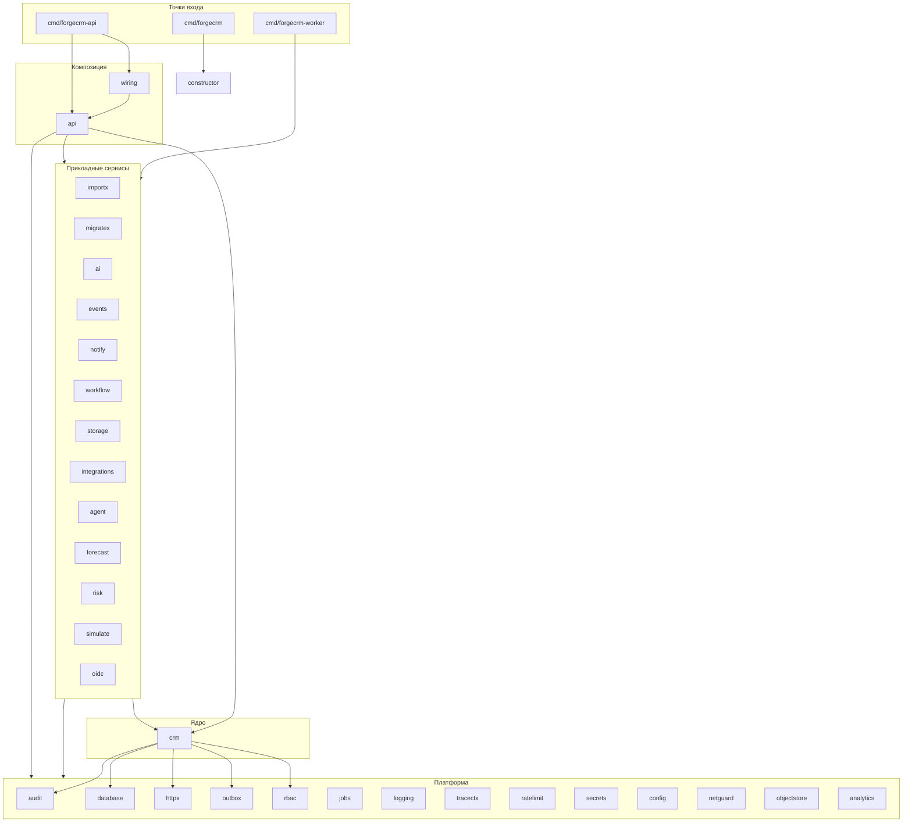

# ForgeCRM — карта зависимостей (Этап A)

- **Дата:** 2026-11-07
- **Коммит:** `main` @ `3424b3e`
- **Метод:** реальный граф импортов через `go list`, а не чтение имён папок.

## Как это получено

```bash
cd backend
go list -f '{{.ImportPath}} {{join .Imports " "}}' ./internal/... ./cmd/... \
  | sed 's#github.com/geff1778/forgecrm/##g'
```

Вывод разобран: оставлены рёбра, чья цель начинается с `internal/`. Затем
посчитаны исходящие степени и выполнен обход в глубину с раскраской (поиск циклов).

## Измеренный результат

| Метрика | Значение |
|---|---|
| Пакетов с исходящими рёбрами (узлы) | 34 |
| Рёбер (импортов `internal/…`) | 197 |
| **Циклов** | **0** |

**Ноль циклов — проверенный факт, а не цель.** Направление зависимостей
одностороннее: `cmd → api → application → core → platform`.

## Слои (по фактическим импортам)

```
cmd/forgecrm-api ─┐
cmd/forgecrm-worker ─┤
                     ▼
              internal/api            (композиция: 72 файла)
                     ▼
   application services: importx, migratex, ai, events, notify,
                         workflow, storage, integrations, agent,
                         forecast, risk, simulate, oidc, mcpcred
                     ▼
        core: crm  (аккаунты, контакты, лиды, сделки, задачи,
                     обращения, активности, поиск, отчёты)
                     ▼
   platform: audit, database, httpx, outbox, rbac, jobs,
             logging, tracectx, ratelimit, secrets, config,
             netguard, objectstore, retention, analytics, views,
             tenantconfig, appearance, idempotency, migrate,
             migrations, constructor
```

## Ключевые рёбра (ядро и границы)

| Пакет | Импортирует `internal/…` |
|---|---|
| `crm` | audit, database, httpx, outbox, rbac |
| `api` | agent, ai, analytics, appearance, audit, authn, config, consent, crm, database, events, forecast, httpx, idempotency, importx, integrations, jobs, logging, mcpcred, metrics, migrate, migratex, notify, oidc, openapi, outbox, ratelimit, rbac, risk, secrets, simulate, storage, telegramtext, tenantconfig, views, workflow |
| `authn` | audit, config, database, logging, rbac, secrets |
| `ai` | agent, audit, config, crm, database, httpx, logging, ratelimit, rbac |
| `notify` | audit, config, database, httpx, rbac, secrets, telegramtext |
| `events` | audit, database, httpx, integrations, logging, outbox, rbac, secrets, tracectx |
| `importx` | audit, config, crm, database, httpx, importx/parsers, importx/safe, jobs, outbox, rbac |
| `migratex` | audit, database, httpx, integrations, rbac, secrets |
| `workflow` | audit, crm, database, httpx, logging, outbox, rbac |
| `storage` | audit, database, httpx, objectstore, rbac |
| `integrations` | audit, database, httpx, netguard, rbac, secrets |
| `forecast` / `risk` / `simulate` | analytics, audit, crm, database, rbac |
| `analytics` | — (чистая арифметика, ноль зависимостей) |
| `database` | — (лист) |

## Mermaid — зависимости модулей (уровень контекстов)



## Владение данными (фактическое)

| Область | Владелец в коде | Таблицы (пример) |
|---|---|---|
| CRM-ядро | `internal/crm` | accounts, contacts, leads, deals, pipelines, tasks, tickets, activities |
| Аутентификация | `internal/authn` | users, sessions, mfa, password_resets |
| RBAC | `internal/rbac` | roles, permissions, role_permissions, memberships |
| Аудит | `internal/audit` | audit_log |
| Очередь | `internal/jobs` | jobs |
| События | `internal/outbox` | outbox_events |
| Импорт | `internal/importx` | import_jobs, import_errors |
| Интеграции | `internal/integrations` | integrations, integration_runs |
| Уведомления | `internal/notify` | notifications, delivery_log |
| Согласие | `internal/consent` | consent_* |
| Тенант-конфиг | `internal/tenantconfig` | tenant_settings |
| Виды | `internal/views` | saved_views |
| Хранилище | `internal/storage` | documents, attachments |

> **Важно:** это **логическое** владение. Физически — одна схема PostgreSQL
> (83 таблицы). Межмодульные обращения к «чужим» таблицам технически не запрещены,
> только конвенцией. Это TD-2 и главный блокер для полноценных микросервисов.

## Правила, обеспеченные тестами (`internal/archtest`, 6 правил)

1. `TestNoPackageImportsAPI` — никто не импортирует `api`.
2. `TestProductionPackagesDoNotImportTestsupport` — тест-скаффолд не утекает в прод.
3. `TestApplicationServicesDependOnTheCoreAndNotTheReverse` — приложение зависит от
   ядра, не наоборот.
4. `TestCoreDoesNotImportCompositionOrHTTP` — ядро свободно от транспорта
   (с известным отклонением `crm → httpx`, TD-1).
5. `TestExtractionBoundaryHolds` — границы извлечения держатся в графе импортов.
6. `TestEveryInternalPackageIsReachableFromACommand` — нет мёртвых пакетов.

## Проверка отсутствия циклов (воспроизводимо)

Любой может повторить:

```bash
cd backend
go list -f '{{.ImportPath}} {{join .Imports " "}}' ./internal/... ./cmd/... \
  | sed 's#github.com/geff1778/forgecrm/##g' > /tmp/graph.txt
# затем обход DFS с раскраской — 0 циклов на аудируемом коммите
```

Плюс постоянный гейт: `go test ./internal/archtest/...`.

## Вывод для программы

- Граф **готов к извлечению** (0 циклов, 36 модулей извлекаются — `EXTRACT_RC=0`).
- Для микросервисов критично **не** направление зависимостей, а **владение
  данными** (TD-2): пока схема одна, «сервисы» будут делить таблицы и станут
  распределённым монолитом.
